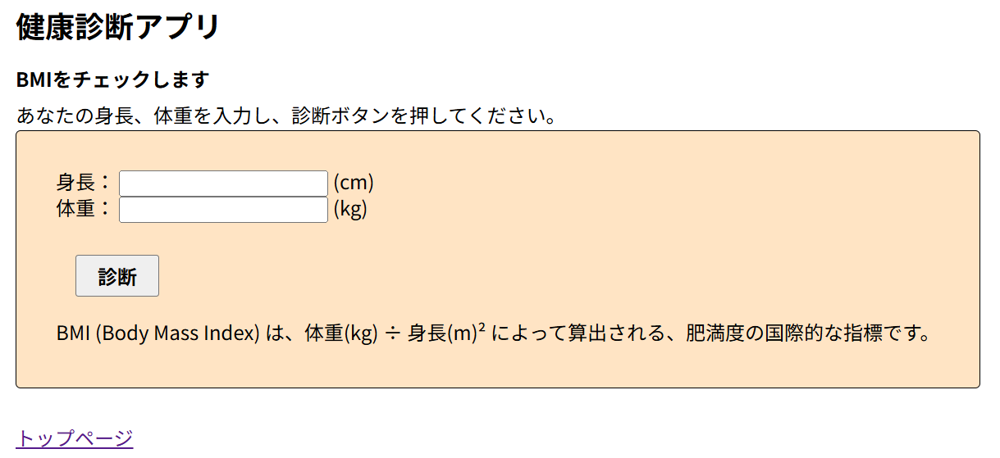
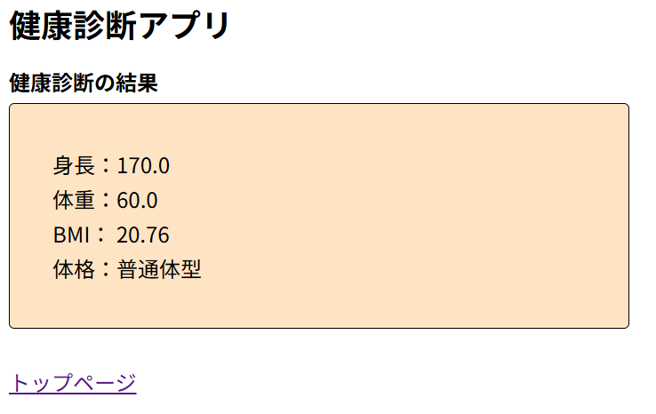

# 健康診断アプリ（HealthCheck）

## 概要

身長と体重を入力することで、BMI を計算し、
体格を判定する Web アプリケーションです。

## 公開 URL

https://healthcheck-li8q.onrender.com/HealthCheck

※Render の無料プランを利用しているため、初回アクセス時は起動まで最大 1 分程度かかる場合があります。

## 画面イメージ

### 入力画面

身長と体重を入力して BMI を診断します。

### 診断結果画面

入力値をもとに BMI を計算し、体格を判定します。

## 主な機能

- 身長・体重の入力
- BMI の計算
- BMI に基づく体格判定
- 診断結果の表示

## 使用技術

- Java 25
- Spring Boot
- Thymeleaf
- HTML / CSS
- Maven
- Docker
- Render

## 開発環境

- OS：Windows
- IDE：Pleiades
- Java：25
- ビルドツール：Maven

## デプロイ

Docker を使用してコンテナ化し、
Render にデプロイしています。

## 開発目的

Java および Spring Boot の学習を目的として開発しました。
Web アプリケーションの作成から Docker による
コンテナ化、クラウド環境へのデプロイまで取り組みました。
